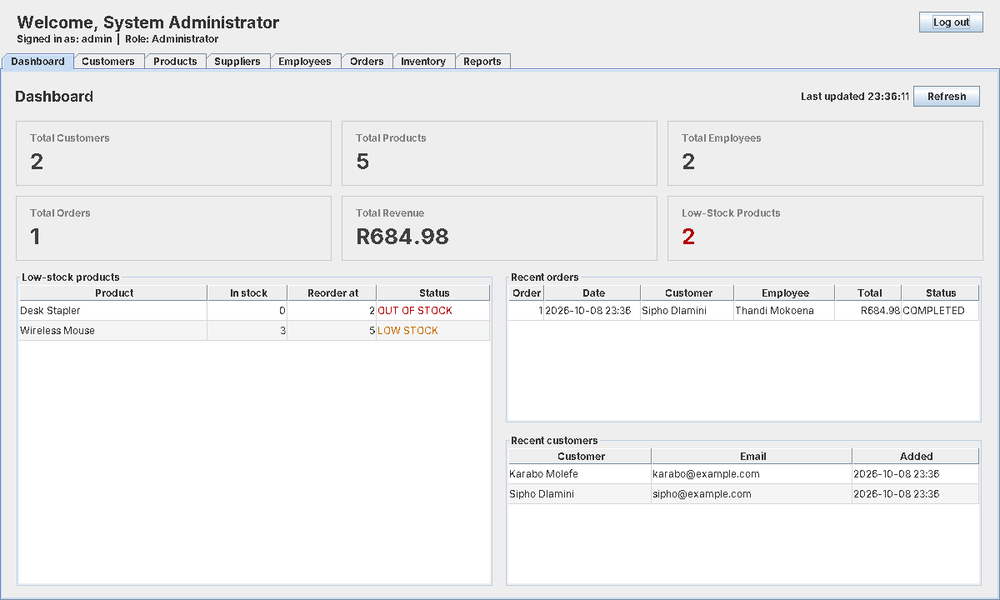
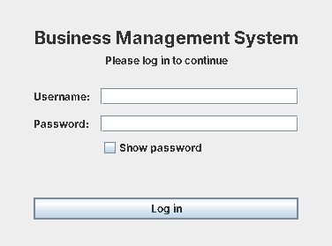
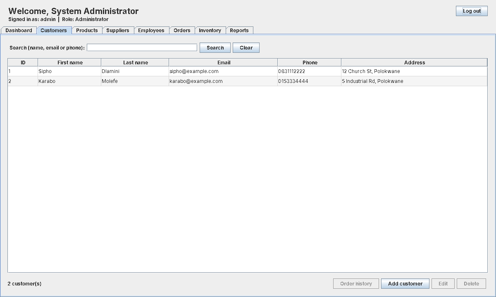
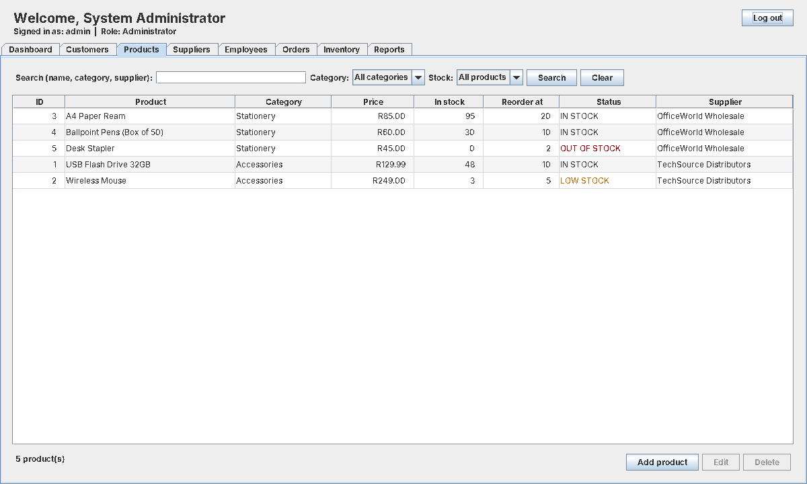
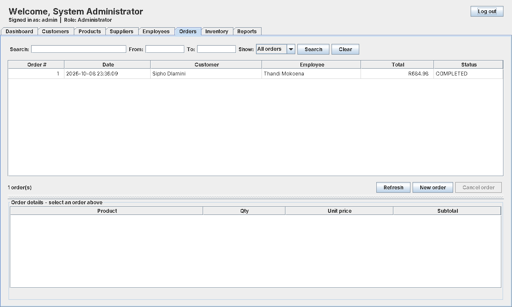
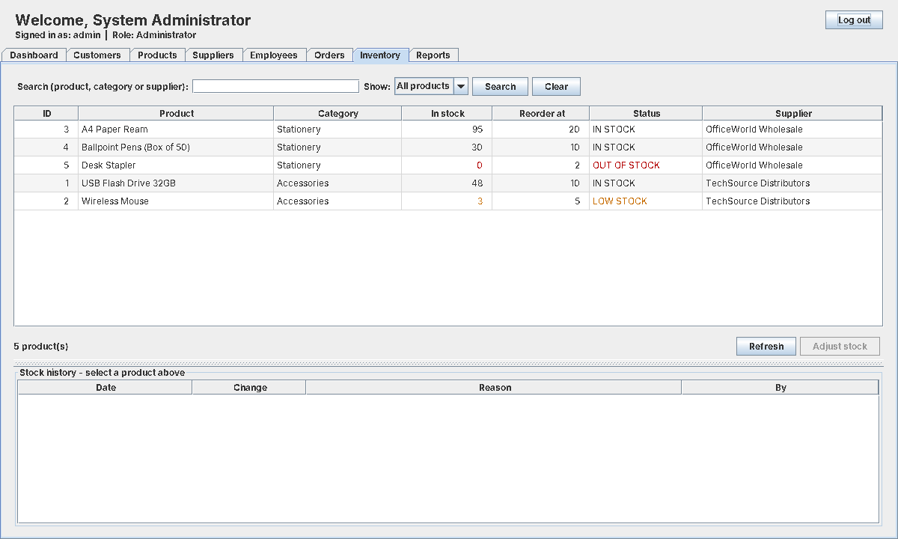
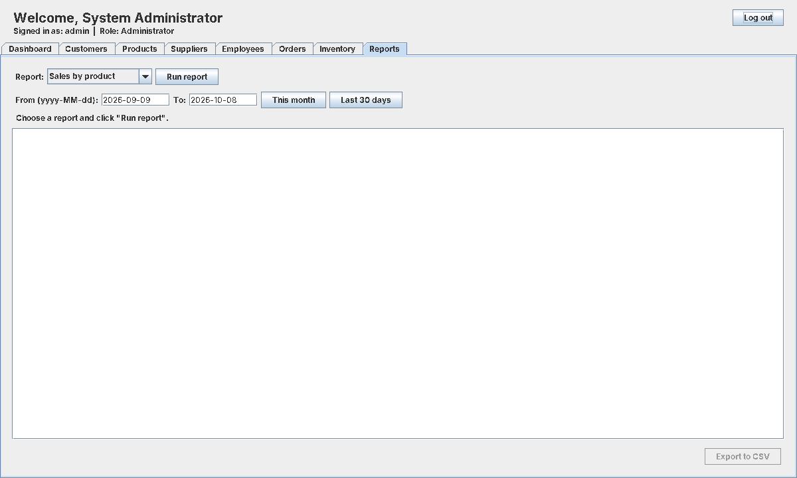
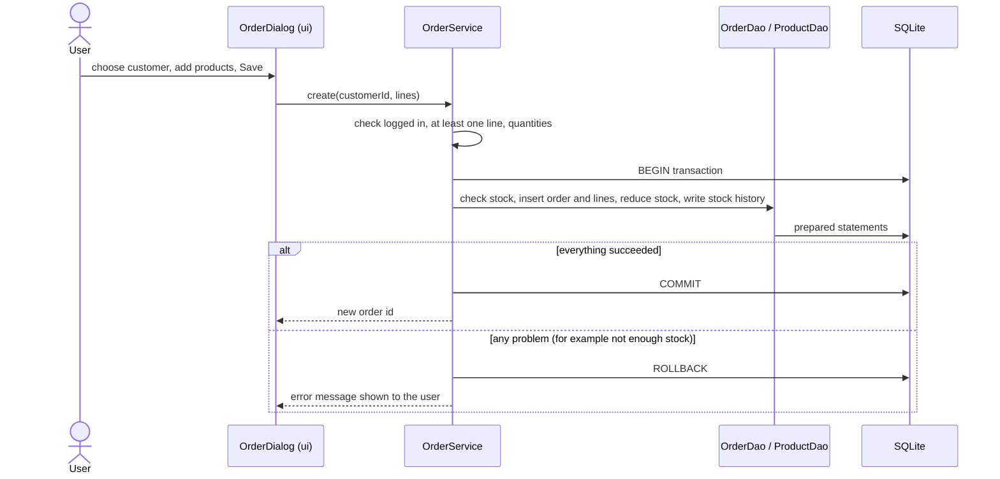
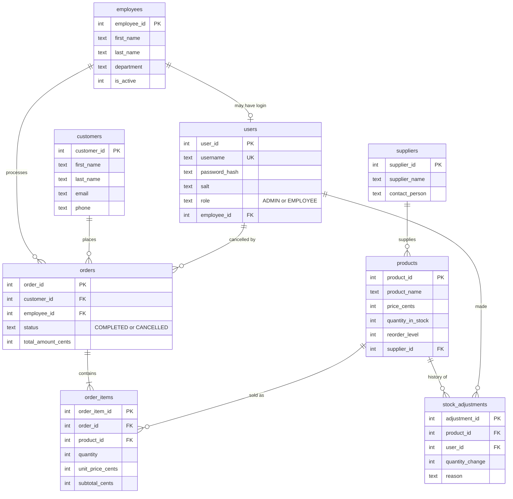

# Business Management System

A desktop application for a small business to manage customers, products, suppliers, employees, stock and sales orders. It is written in **Java (Swing)** and stores its data in a local **SQLite** database through **JDBC**. It was built as an IT Business Systems portfolio project, one phase at a time (requirements, UML, database design, then each module, then testing).

Everything used is free and open source. There is no server, no account to create and no internet connection needed to run it.



## Features

Two roles: **Administrator** and **Employee**. The screens a user sees depend on the role.

| Module | Administrator | Employee |
|---|---|---|
| Login / logout | Yes | Yes |
| Dashboard (totals, low-stock list, recent orders and customers) | Whole business | Limited view |
| Customers (add, edit, search, order history) | Yes, and can delete a customer who has no orders | Add, edit, search, history |
| Products (add, edit, search, stock filter) | Yes, including delete | View and search only |
| Suppliers | Yes | No access |
| Employees and user accounts (create login, role, deactivate, department filter) | Yes | No access |
| Inventory (stock levels, history, adjust stock with a reason) | View and adjust | View only |
| Orders (create, search, date filter, order details) | Create, view, **cancel** (stock is returned) | Create and view |
| Reports (sales by product, employee, customer and day; stock levels and value; low stock; export to CSV) | Yes | No access |

Other behaviour worth knowing:
- Passwords are stored as salted PBKDF2 hashes, never as plain text.
- Money is stored as whole cents, so there are no rounding errors.
- Customers, products, suppliers and employees are "soft deleted" (hidden, not erased) and are refused deletion while they are used by orders or products, so history stays correct.
- Creating or cancelling an order, adding a product with stock, and creating an employee with a login each happen in one database transaction: either all of it is saved or none of it.
- Friendly error messages for bad input and for a locked database. Technical detail goes to `logs/bms.0.log`; passwords are never logged.

## Screenshots

Taken from the running application with the demo data (rendered on Linux, so fonts differ slightly from Windows).

| | |
|---|---|
|  |  |
|  |  |
|  |  |

## Technology

| Part | Choice |
|---|---|
| Language | Java 17 or newer (developed with NetBeans and JDK 26) |
| User interface | Java Swing |
| Database | SQLite, one local file |
| Database access | JDBC with prepared statements only (`org.xerial:sqlite-jdbc` 3.45.3.0) |
| Build | Maven (used only to download the SQLite driver and build) |
| Version control | Git and GitHub |

## How to run it

You need a JDK (17 or newer), Maven and, optionally, NetBeans.

**In NetBeans:** open the project folder, choose *Build*, then right-click `src/main/java/com/bms/Main.java` and *Run File*.

**From a terminal:**
```
mvn compile
mvn dependency:copy-dependencies
java -cp "target/classes;target/dependency/*" com.bms.Main
```
(on Linux or macOS use `:` instead of `;`).

On first start the program creates `data/bms.db`, all tables, a default administrator and some demo data.

| Role | Username | Password |
|---|---|---|
| Administrator | `admin` | `Admin@123` |
| Employee (demo) | `thandi` | `Employee@123` |

These are demo passwords written in this README, so **change them before using real data** (Employees tab, edit the account).

To start again from clean demo data, close the app and delete the `data` folder.

## Architecture

The code is split into layers so that each class has one job. A screen never talks to the database directly.

```
UI (Swing)  ->  Service  ->  DAO  ->  SQLite
 ui/            service/     dao/     database/
```

| Package `com.bms.` | Responsibility |
|---|---|
| `ui` | Windows, panels and dialogs. Show data, collect input, show messages. |
| `service` | Business rules: validation, who is allowed to do what (`Session.requireAdmin()`), transactions. |
| `dao` | Data access objects. The only classes that contain SQL (prepared statements). |
| `database` | Connection (foreign keys switched on), table creation, demo data. |
| `model` | Plain data classes (`Customer`, `Product`, `CustomerOrder`, ...). |
| `util` | Password hashing, session, logging, error handling, text rules, CSV export. |
| `exception` | `ValidationException`, `AuthenticationException`, `AccessDeniedException`, `DatabaseException`. |

Why the service layer matters: the permission check lives there, not only in the UI. Hiding a button is not security, so the rule is enforced again before any data changes.

### How creating an order works



## Database design

Nine tables, three read-only views for reporting, and indexes on the columns that are searched.



The diagram shows the main columns only. A ninth table, `settings` (key/value pairs such as business name and currency symbol), is not shown. Views: `v_inventory`, `v_order_summary`, `v_order_item_details`.

Rules enforced by the database itself (`CHECK`, `UNIQUE`, foreign keys), not only by the Java code:
- stock can never be negative, prices can never be negative;
- `subtotal = quantity * unit price` on every order line, and a product appears once per order;
- a cancelled order must have a cancel date and user, a completed one must not;
- you cannot delete a row that other rows still point to (`ON DELETE RESTRICT`).

## Testing

Details are in [`docs/testing/TEST_PLAN.md`](docs/testing/TEST_PLAN.md).

- **Automated self-checks:** 14 console programs call the real services and database and clean up after themselves. Run `src/main/java/com/bms/AllChecks.java` to run them all. It prints `ALL SUITES PASSED.` when every check passes and writes the real results to `docs/testing/automated-results.md`. At the time of writing, 587 of 587 checks passed on the developer's machine.
- **Volume test:** 3,000 customers, 1,500 products and 1,300 orders for one customer, with a speed limit of 3 seconds per operation.
- **Data integrity audit:** a read-only check of the whole database (totals, stock, foreign keys, password hashes).
- **Manual test cases:** 50 cases in the test plan. The Actual and Status columns are filled in by whoever runs them.

Testing found and fixed real problems, for example the Orders list being silently cut at 1,000 rows. These are listed in the test plan.

## Project structure

```
business-management-system/
  pom.xml
  docs/
    images/              screenshots used in this README
    testing/             test plan and generated test results
  src/main/java/com/bms/
    Main.java            starts the application
    AllChecks.java       runs every self-check
    ui/  service/  dao/  database/  model/  util/  exception/
  data/                  created on first run (not in Git): bms.db
  logs/                  created on first run (not in Git): bms.0.log
```

## Known limitations

This is a learning project, and these are known gaps rather than hidden ones:

- One user on one computer. The database is a single local file, so it is not a multi-user or network system.
- There is no Settings screen. Business name, currency symbol and the default low-stock level can only be changed in the database.
- There is no separate Users tab. Accounts and roles are managed in the Employees tab.
- Deactivating a user who is logged in does not log them out until they log out themselves.
- Lists refresh when you open a tab, not live while you stay on it.
- No lockout after repeated failed logins, and no password reset by e-mail.
- No tax calculation, no invoices or printing, and no backup feature (copy `data/bms.db` yourself while the app is closed).
- The Orders list shows at most the newest 1,000 orders (the screen says so when it happens).
- Only the demo and default passwords above exist at first start.

## Possible future work (Version 2)

A web version with a React front end, a Spring Boot REST API and PostgreSQL, so that several people can use the system at once from different computers. The layers here (UI, service, DAO) were kept separate so the business rules can be reused in that design. This is a plan only; none of it is built.

## Author

Built by an IT Business Systems student as a portfolio project.
